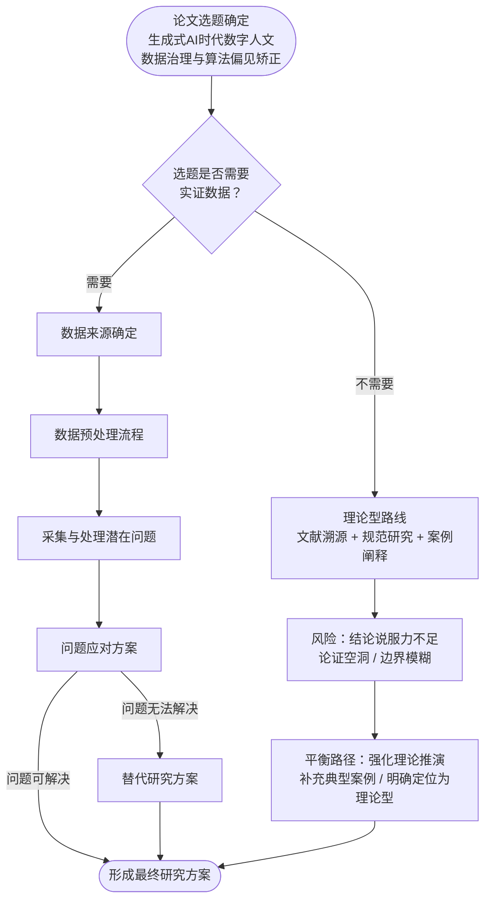
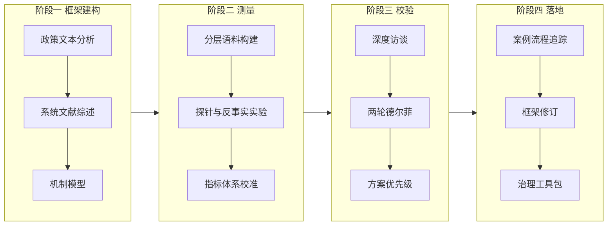
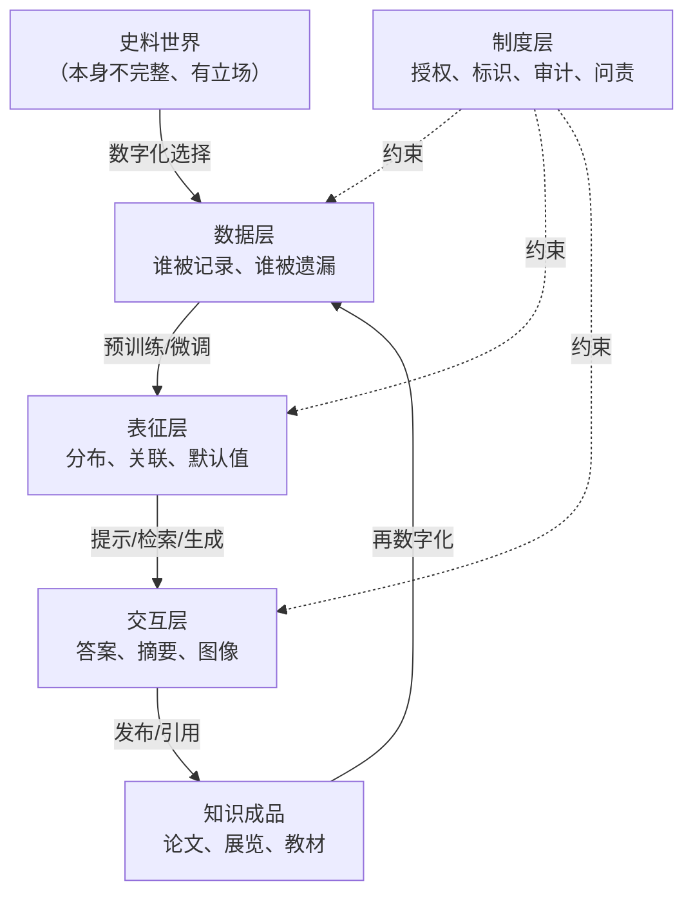

# 生成式 AI 时代数字人文数据治理与算法偏见矫正研究

**研究汇报文档**

| 项目 | 内容 |
|---|---|
| 研究类型 | 理论建构 + 实证检验的混合研究（解释性序列设计） |
| 报告版本 | V1.0 |
| 编制日期 | 2026-11-12 |
| 文档性质 | 研究方案与阶段性成果汇报 |
| 关 键 词 | 数字人文；数据治理；算法偏见；生成式人工智能；可纠正性 |

> **阅读指引**：本报告按"论文研究设计决策流程图"的节点顺序组织。第二章完整走一遍决策链（选题 → 是否需要实证 → 数据来源 → 预处理 → 潜在问题 → 应对方案 → 替代方案 → 最终方案），第三章以后是走完决策链之后的实质研究内容。若只关心结论，可直接读摘要、第七章与第十一章。

---

## 摘要

生成式人工智能进入数字人文的史料生产链之后，"数据治理"与"算法偏见"从两个相对独立的研究议题，变成了同一个问题的两面：**模型输出的偏见，本质上是数据治理失效在生成端的显影；而数据治理的失效，又长期被人文数据"开放共享"的规范性话语所遮蔽。**

本研究以"生成式 AI 时代数字人文数据治理与算法偏见矫正"为对象，提出三个基本判断：

1. **偏见具有层间转移性**。偏见不会因为一次技术干预而消失，只会在数据层、表征层、交互层、制度层之间转移。因此治理目标不应设定为"偏见归零"，而应设定为"可观测、可归责、可救济"。
2. **数字人文拥有被低估的矫正资源**。人文研究固有的"来源批判"传统，可以转化为技术上的"来源链"（provenance chain）要求，这是本领域相对于通用 AI 治理的独特杠杆。
3. **现有治理规则"标识强、审计弱，准入强、过程弱，通用强、领域弱"**。数字人文需要的不是又一份通用原则，而是一套可嵌入具体工作流的控制点。

在方法上，本研究采用解释性序列混合设计：以政策文本与公开案例的证据综合建立分析框架，以分层抽样的语料实验测量偏见，以专家访谈与德尔菲法校验治理方案。核心产出是一个"**四层治理—七阶段控制—九法矫正**"的框架，以及一套面向中文/文言场景的偏见评测维度。

**结论**：算法偏见矫正的成败，不取决于去偏算法的先进程度，而取决于治理流程是否在"采集—清洗—标注—训练—检索—生成—发布"的每个环节都设置了可核查的控制点，以及是否为人文学者保留了"不信任输出"的制度空间。

---

## 一、研究缘起与问题提出

### 1.1 三重变局的同时发生

**第一重：数字人文从"项目制"走向"基础设施"。**

过去二十年，数字人文完成了从"把材料搬上网"到"把材料变成可计算对象"的转变。中国历代人物传记资料库（CBDB）积累了逾六十万人物记录，成为历史社会学与群体传记学的基础设施[1]；国家图书馆"中华古籍智慧化服务平台"、字节跳动与北京大学合作的"识典古籍"（已收录七万余部古籍）等平台，把古籍从影像推进到全文与知识组织层面[2]；国际上，Europeana、HathiTrust 等聚合平台把文化遗产数据推入千万级规模。数据一旦成为基础设施，其质量问题就不再是"技术瑕疵"，而是**知识生产条件的缺陷**。

**第二重：生成式 AI 进入史料生产链。**

大模型不再只是检索工具，而是开始承担标点、断句、翻译、摘要、实体抽取、问答、乃至历史图像生成等任务。2026 年"我用 AI 校古籍"项目累计完成十五亿字粗校，说明机器已经实质性地参与到文本校勘这一最核心的人文工序中[3]。这意味着：**模型不再站在史料之外，而是站在史料与读者之间**。它一旦有偏，偏见就随输出一起进入学术引用链。

**第三重：治理规则密集落地。**

中国方面，《数据安全法》《个人信息保护法》确立了数据分类分级与个人信息处理的基本框架；《生成式人工智能服务管理暂行办法》（2023 年 8 月 15 日施行）确立了训练数据合法性、标注规范、生成内容标识等义务[4]；《人工智能生成合成内容标识办法》（2025 年 9 月 1 日施行）进一步把"显式标识 + 隐式标识"落为可执行要求[5]。欧盟《人工智能法案》分阶段生效，通用人工智能模型义务已于 2025 年 8 月起适用，高风险系统义务原定 2026 年 8 月，2026 年出现延期与调整动议[6]。UNESCO 2021 年《人工智能伦理问题建议书》则提供了全球性价值框架。

三重变局交汇处，出现了本研究的核心矛盾。

### 1.2 核心矛盾：三个"目标函数"不一致

| 主体 | 核心诉求 | 行为逻辑 | 与治理的冲突点 |
|---|---|---|---|
| 数字人文 | 开放、可及、可解释、可复现 | 尽量多地把材料数字化并开放 | 开放与授权、隐私、族群敏感内容冲突 |
| 生成式 AI | 规模、流畅、覆盖长尾 | 尽可能多地吸收语料 | 规模与质量、授权、代表性冲突 |
| 治理体系 | 安全、合规、可控、可追责 | 设门槛、加标识、做审计 | 合规成本与科研效率、通用规则与领域知识冲突 |

三者的目标函数不一致，导致一个典型困境：**越是开放的数字人文数据，越容易被抓取训练；越是被抓取训练，原始社区越难获得回报与纠错权。** 这就是文化遗产领域讨论的"文化 AI"与"慢图书馆"问题——数字化本身从来不是中立的搬运[7]。

### 1.3 问题链：从"可得"到"可纠"

本研究把问题拆成递进的四环：

```
数据可得 → 数据可信 → 算法可纠 → 治理可行
   （量）      （质）       （效）      （制）
```

- **可得**：材料是否数字化、是否授权、是否机器可读。
- **可信**：元数据是否准确、文本是否可靠、标注是否一致。
- **可纠**：偏见是否可测量、干预是否有效、纠偏是否可复现。
- **可行**：治理措施是否可负担、可执行、可问责。

多数既有研究停在第一环或第二环，少数进入第三环，几乎没有人把第四环与前三环打通。本研究要打通的正是这条链。

### 1.4 研究问题

- **RQ1（机制）**：生成式 AI 在数字人文数据生命周期中引入了哪些新型偏见？其生成机制与传导路径是什么？
- **RQ2（测量）**：如何构建一套适用于中文/文言与文化遗产场景的偏见测量指标与评测集？
- **RQ3（矫正）**：在"有效性—成本—可解释性"三重约束下，何种矫正策略组合最优？纠偏的副作用如何识别？
- **RQ4（治理）**：面向中国制度语境，数字人文数据治理应如何在数据、模型、输出、制度四个层面设置控制点？

### 1.5 研究意义

**理论意义**：把"算法偏见"从通用 AI 伦理话语中剥离出来，放回人文知识生产的具体工序中考察，提出"层间转移"与"可纠正性"两个概念，弥补"技术去偏"与"政策文本"之间的中层理论空白。

**实践意义**：为古籍智能整理平台、历史人物问答系统、文化遗产图像生成等具体应用提供可操作的偏见审计清单与治理工具包。

**政策意义**：为《生成式人工智能服务管理暂行办法》《人工智能生成合成内容标识办法》在文化遗产领域的实施细则提供领域化建议。

---

## 二、研究设计：沿决策链走一遍

> 本章对应流程图的全过程。每一步给出"图中节点 → 本研究动作 → 交付物"的映射，确保研究不是凭直觉展开，而是可追溯的设计决策。

### 2.0 决策链总览（流程图复刻）

**图 2-1 决策链总览**



**节点映射表**

| 流程图节点 | 本研究对应动作 | 交付物 |
|---|---|---|
| 论文选题确定 | 题目拆解为四个概念并界定关系 | 概念矩阵（表 2-1） |
| 是否需要实证数据 | 判定"需要，但分层" | 判定理由与分层实证设计 |
| 不需要 → 理论路线 | 保留为"理论支撑层"，不作主线 | 文献综述与规范分析 |
| 数据来源确定 | 四类数据源与获取方式 | 数据源清单（表 2-2） |
| 数据预处理流程 | 清洗、对齐、编码、抽样、变量构造、信效度 | 预处理 SOP（表 2-3） |
| 采集与处理潜在问题 | 五类风险识别与分级 | 风险登记册（表 2-4） |
| 问题应对方案 | 风险—对策矩阵 | 对策矩阵（表 2-5） |
| 问题无法解决 → 替代方案 | 四条降级路径与触发条件 | 替代方案（表 2-6） |
| 形成最终研究方案 | 技术路线图与进度安排 | 图 2-2、表 12-1 |

### 2.1 节点一：选题确定——把标题拆成四个概念

标题不是一句话，而是一组关系。拆解如下：

**表 2-1 概念矩阵**

| 概念 | 在标题中的功能 | 操作化定义 | 本研究如何处理 |
|---|---|---|---|
| 生成式 AI | 时代条件（自变量背景） | 以大规模语料预训练、能生成文本/图像/多模态内容的模型系统 | 作为"技术变量"，考察其对数据治理与偏见形态的改写 |
| 数字人文 | 领域限定（场域） | 以计算方法处理人文材料、并以人文问题为导向的研究与实践 | 作为"知识生产场域"，提供领域知识与评价标准 |
| 数据治理 | 手段/对象（中介变量） | 对数据全生命周期的制度、流程、技术与组织安排 | 作为"干预变量"，是矫正偏见的抓手 |
| 算法偏见矫正 | 目标（因变量） | 降低模型输出中系统性、可重复的不公平，并提升可纠正性 | 作为"结果变量"，需可测量 |

四者的关系可表述为：**生成式 AI 改变了数字人文数据的生产与使用方式，使既有数据治理安排失效；治理失效在模型输出端表现为算法偏见；矫正偏见必须回到治理流程，而非只在模型端做技术修补。**

这个表述本身就构成了研究的分析主线。

### 2.2 节点二：是否需要实证数据？——判定"需要，但分层"

这是整张图的枢纽。本研究给出**肯定判断**，理由三条：

1. **偏见是可观测的经验现象**。无论是语料覆盖偏斜、词向量刻板关联，还是生成文本的时代错置，都可以通过分布比较、探针任务、反事实替换来测量。若不做实证，"偏见"就只能停留在举例层面，无法回答"多严重""是否改善"。
2. **治理方案需要有效性证据**。RAG、去偏微调、提示约束、人工复核，哪种组合在什么条件下有效，只能通过对照实验回答。纯规范研究容易产出"正确的废话"。
3. **政策评估需要案例**。中国现行规则以"标识""备案""安全评估"为主，其在文化遗产场景的实际效果，需要案例层面的过程追踪。

**但本研究不追求"大样本实证"，而采用"分层实证"：**

| 层次 | 内容 | 规模 | 目的 |
|---|---|---|---|
| L1 证据综合 | 政策文本、平台文档、公开案例、已有实验 | 全量可得 | 建立框架与风险清单 |
| L2 小规模实验 | 分层语料 + 探针任务 + 反事实测试 | 可控、可复现 | 验证机制、校准指标 |
| L3 专家校验 | 深度访谈 + 两轮德尔菲 | 15–20 人 | 校验治理方案的可行性与优先级 |
| L4 案例追踪 | 1–2 个平台的流程观察 | 深度个案 | 检验框架的落地性 |

**为什么不是"纯理论路线"？** 因为标题中的"矫正"是一个效果性概念——不测量就无法声称"矫正了"。若走纯理论路线，就必然会落入流程图左支所警示的"结论说服力不足、论证内容空洞、难以回应审稿质疑"。

**为什么不是"大规模实证"？** 因为数字人文场景的数据授权成本高、标注需要领域专家、伦理审查严格。用"小规模、深测量、可复现"换"大规模、浅测量、难复现"，是这个领域的理性选择。

### 2.3 左支的处理：把"理论路线"降为支撑层

流程图左支并非被否定，而是被**降格使用**。本研究保留其四项动作，作为实证的支撑：

| 左支动作 | 在本研究中的位置 | 具体做法 |
|---|---|---|
| 强化文献溯源与理论推演 | 第三章、第四章 | 系统综述 + 机制建模 |
| 补充典型案例与文本证据 | 第六章 | 案例证据综合，标注证据强度 |
| 采用规范/质性研究范式 | 第五、七章 | 政策文本分析、专家访谈、框架构建 |
| 明确定位为理论型研究 | 不适用 | 本研究定位为"理论建构 + 实证检验"的混合研究 |

这样处理，既避免了"无实证支撑"的软肋，也避免了"实证至上"而丢失人文解释深度。

### 2.4 右支第一步：数据来源确定

**表 2-2 四类数据源**

| 类别 | 具体来源 | 规模预估 | 用途 | 获取方式 | 主要风险 |
|---|---|---|---|---|---|
| A. 人文语料库 | CBDB、中华古籍智慧化服务平台、识典古籍、地方志数据库、敦煌文献库 | 数十万至千万级条目 | 测量语料覆盖与代表性 | 公开 API / 机构授权 / 合作 | 授权范围、脱敏、版本不一致 |
| B. 政策与行业文本 | 《数据安全法》《个人信息保护法》《暂行办法》《标识办法》、EU AI Act、UNESCO 建议书、行业标准 | 约 30–50 份 | 制度层分析、合规对照 | 官方公开 | 版本更新、解释口径差异 |
| C. 模型输出 | 主流中文大模型 API 的历史问答、摘要、实体抽取、图像生成结果 | 每任务 500–2000 条 | 测量交互层偏见与幻觉 | API 调用（留存日志） | 条款限制、结果不可复现、成本 |
| D. 人的数据 | 数字人文研究者、古籍整理者、平台开发者、伦理审查人员 | 15–20 人 | 校验风险清单与对策优先级 | 半结构化访谈 + 德尔菲 | 知情同意、匿名化、立场偏差 |

**采样策略**：A 类按"朝代 × 文体 × 地域 × 性别"四维分层；C 类按"任务类型 × 提示模板 × 模型"三因素设计；D 类按"学界 / 平台 / 馆藏机构 / 监管"四类配额抽样。

### 2.5 右支第二步：数据预处理流程

**表 2-3 预处理 SOP**

| 步骤 | 操作 | 工具/方法 | 质量控制 | 产出 |
|---|---|---|---|---|
| 1 清洗 | 去重、去噪、剔除乱码与残缺条目 | 规则 + 相似度去重 | 重复率 < 2% | 干净语料集 |
| 2 对齐 | 人物—时间—地点—事件四要素对齐；异体字、繁简、避讳处理 | 实体链接、规范化词表 | 对齐准确率抽检 ≥ 95% | 结构化数据集 |
| 3 编码 | 性别、族群、身份、朝代、地域编码 | 受控词表 + 双人编码 | 编码者间 Kappa ≥ 0.8 | 编码表 |
| 4 抽样 | 分层抽样，保证长尾群体可测 | 分层 + 过采样少数类 | 每层最小样本量 ≥ 100 | 实验样本 |
| 5 变量构造 | 覆盖率、偏离度、刻板关联强度、反事实翻转率 | 见 5.3 指标体系 | 预注册分析方案 | 变量表 |
| 6 信效度 | 内容效度（专家）、结构效度（因子分析）、重测信度 | 专家评分 + 复测 | Cronbach's α ≥ 0.7 | 效度报告 |

**关键设计**：预处理阶段就引入"**偏见影响评估**"——每清洗掉一类数据，都要记录它属于哪个群体，避免"清洗即删除少数"。这是数字人文场景特有的陷阱：异体字、方言词、少数民族文献往往最先被"清洗"掉。

### 2.6 右支第三步：采集与处理潜在问题

**表 2-4 风险登记册（按可能性 × 影响分级）**

| 编号 | 风险 | 具体表现 | 后果 | 等级 |
|---|---|---|---|---|
| R1 | 样本量不足、代表性偏差 | 冷门朝代、女性、少数民族、地方文献条目稀少 | 结论只适用于"精英—中心"样本 | 高 |
| R2 | 数据失真、主观偏差 | 元数据错漏、传世文献本身的书写偏向、访谈对象的立场 | 把"史料的偏见"误判为"算法的偏见" | 高 |
| R3 | 伦理与授权合规风险 | 族谱、契约、墓葬、医疗等敏感信息；数据库授权范围限制 | 研究不可发表、平台被追责 | 高 |
| R4 | 变量测量效度不足 | 用通用指标测人文偏见，构念错配 | 测到的不是想测的 | 中高 |
| R5 | 关键数据缺失、异常无法修复 | API 不可用、模型版本下线、日志不完整 | 实验不可复现 | 中 |
| R6 | 模型黑箱与版本漂移 | 闭源模型无法做内部探针；版本更新导致结果变化 | 归因困难、结论时效短 | 中 |
| R7 | 研究者自身立场偏差 | 以"纠偏"为名强化某种叙事 | 规范性风险 | 中 |

### 2.7 右支第四步：问题应对方案

**表 2-5 风险—对策矩阵**

| 风险 | 对策 | 具体做法 | 残余风险 |
|---|---|---|---|
| R1 | 扩大样本 + 分层抽样 + 过采样 | 对长尾群体定向补采；报告每层样本量与置信区间 | 长尾仍不足，需在结论中限定 |
| R2 | 多源交叉核验 | 至少两个独立来源互证；区分"史料偏见"与"算法偏见" | 来源同源时失效 |
| R3 | 完善伦理审查与知情同意 | 机构伦理审查；数据分级；敏感字段脱敏；授权范围留痕 | 二次识别风险 |
| R4 | 调整测量指标 + 补充替代变量 | 通用指标（WEAT/BBQ）+ 领域指标（时代错置率、引文可核率） | 指标仍不完备 |
| R5 | 多重插补 + 稳健性检验 + 复现包 | 记录模型版本、提示、随机种子；提供复现脚本 | 闭源模型不可复现 |
| R6 | 黑箱外部审计 + 多模型对照 | 用行为测试替代内部探针；至少 3 个模型横向比较 | 结论外推受限 |
| R7 | 立场声明 + 同行审议 + 反方视角 | 预注册；邀请持不同立场专家评议 | 难以完全消除 |

### 2.8 右支第五步：替代研究方案（触发条件与降级路径）

流程图的虚线"问题无法解决"不是失败，而是**预案**。本研究预设四条触发条件与对应降级路径：

**表 2-6 替代方案**

| 触发条件 | 降级路径 | 代价 | 效力边界 |
|---|---|---|---|
| 核心数据库无法授权 | 改用公开数据集（如开放古籍库、公开 API） | 覆盖面下降 | 结论限定于公开语料 |
| 样本量始终不足 | 缩小研究问题与样本范围，转为深度个案 | 外部效度下降 | 只做机制解释，不做总体推断 |
| 伦理审查不通过 | 改用质性案例研究 + 政策文本分析 | 失去定量证据 | 转为规范研究 |
| 模型不可用/成本过高 | 用二手公开数据 + 已有评测结果补充论证 | 时效性下降 | 依赖他人实验 |
| 全部路径受阻 | 模拟推演数据做辅助支撑（明确标注为模拟） | 证据等级最低 | 仅作框架演示，不作结论依据 |

**原则**：任何降级都必须在文中显式声明，并说明"哪些结论仍然成立、哪些不再成立"。这正是流程图左支"明确定位"的要求。

### 2.9 汇合：最终研究方案

**图 2-2 技术路线图**



**方法定位**：解释性序列混合设计（QUAN → qual → framework）。先量化测量"偏在哪里、偏多少"，再质性解释"为什么偏、如何纠"，最后建构"怎么治"。

---

## 三、概念界定与文献综述

### 3.1 数字人文数据治理

**定义**：数字人文数据治理，是指对人文材料在"采集—描述—组织—存储—使用—复用—归档"全生命周期中所涉及的权属、质量、标准、安全与伦理问题，作出的制度性、流程性与技术性安排。

它与一般数据治理的差别有三点：

1. **对象特殊**：人文数据多为"唯一性"资源（孤本、档案、口述），不可再生，损毁即永久损失。
2. **解释依赖**：同一条数据在不同史学范式下有不同含义，元数据无法完全承载解释。
3. **价值多重**：既是研究资料，也是文化遗产，还可能是族群/家族的敏感记忆。

**四类治理对象**：

| 类型 | 例子 | 治理重点 |
|---|---|---|
| 原生数字数据 | 数字人文项目产出的标注、可视化、数据库 | 版本、可复现、开放许可 |
| 数字化数据 | 古籍影像、拓片、档案扫描件 | 图像质量、OCR 准确率、色彩管理 |
| 元数据 | 编目、人物关系、地理信息 | 标准一致性、来源可追溯 |
| 衍生数据 | 模型输出、摘要、翻译、知识图谱 | 标识、责任归属、二次使用边界 |

现有研究多聚焦前三类，**第四类"衍生数据"的治理几乎空白**——而这恰恰是生成式 AI 带来的新问题。

### 3.2 算法偏见

**定义**：算法偏见指算法系统在输出中对特定群体或属性产生系统性、可重复的偏差，且该偏差缺乏正当理由。

**类型学**（本研究采用四层分类，与第四章框架对应）：

| 层次 | 偏见类型 | 数字人文场景表现 |
|---|---|---|
| 数据层 | 选择偏见、标注偏见、历史偏见 | 语料只覆盖精英阶层；传世文献本身"沉默"了底层 |
| 表征层 | 分布偏见、语义偏见 | 词向量中"女性—内宅""胡人—野蛮"的关联 |
| 交互层 | 提示偏见、检索偏见、生成偏见 | 问"古代女性做什么"只答"相夫教子" |
| 制度层 | 部署偏见、问责偏见 | 平台只对合规负责，不对知识准确性负责 |

**与"史学偏见"的区别**：史学偏见是解释立场问题，无法也不必"消除"；算法偏见是分布偏移问题，可以测量、可以干预。混淆二者，会导致两种错误——要么把史学争论误判为技术缺陷，要么用技术中立掩盖立场问题。**本研究的处理原则是：区分"史料的不完整"与"模型对不完整的放大"。**

### 3.3 生成式 AI 带来的三重改写

| 维度 | 传统数字人文 | 生成式 AI 时代 | 治理含义 |
|---|---|---|---|
| 检索 → 生成 | 用户自己判断相关性 | 模型直接给出"答案" | 从"提供材料"变为"提供结论"，责任前移 |
| 工具 → 合作者 | 工具无作者身份 | 模型参与写作、翻译、断句 | 署名、责任、透明度问题 |
| 语料 → 训练数据 | 语料用于检索与统计 | 语料被吸收进参数 | 授权、收益分配、退出权问题 |

第三点尤其关键：**一旦语料进入参数，原始数据的"可删除性"就消失了**。这与《个人信息保护法》的删除权、文化遗产社区的"退出权"形成结构性冲突。

### 3.4 研究缺口

1. **技术去偏研究**（fairness ML）提供了大量算法，但几乎不处理"人文数据的稀疏性与解释性"，指标在长尾场景失效。
2. **政策研究**提供了原则与框架，但缺少"控制点"层面的可操作设计，落地时容易变成合规表演。
3. **数字人文研究**有丰富的来源批判传统，但很少把它转译为可计算的质量要求。
4. **中文/文言场景**的偏见评测集几乎空白，现有基准（CrowS-Pairs、StereoSet、BBQ）以英文为主。
5. **纠偏的副作用**（过度矫正、偏见转移、以"公平"之名抹平差异）缺乏系统研究。

本研究定位在上述五个缺口的交叉处。

---

## 四、理论框架

### 4.1 三层偏见生成机制



**机制解释**：

- **放大效应**：史料中 5% 的偏斜，经过预训练可能放大为 20% 的输出偏斜，因为模型学习的是"统计上的默认"。
- **固化效应**：模型输出被再次数字化、再次训练，形成"偏见回流"（model collapse 的社会版本）。
- **遮蔽效应**：生成文本的流畅性掩盖了证据的薄弱，读者难以察觉"这段话没有史料支撑"。

### 4.2 三重批判链

本研究把人文研究的批判传统转译为技术流程：

| 批判 | 人文原型 | 技术转译 | 治理工具 |
|---|---|---|---|
| 来源批判 | 辨伪、考据、版本学 | 数据来源、授权、版本、采集时间可追溯 | 来源链（provenance） |
| 数据批判 | "数据不是给定的，而是被建构的"（data as capta） | 元数据、编码方案、缺失机制透明 | 数据卡（datasheet） |
| 算法批判 | 反思解释立场与权力 | 模型卡、行为测试、反事实检验 | 模型卡 + 偏见审计 |

这三重批判构成一个"证据等级阶梯"：**能溯源 → 能解释 → 能质疑**。数字人文的相对优势正在于第一层，短板在第三层。

### 4.3 核心概念：可纠正性（Correctability）

本研究主张，治理目标不应是"公平"这一模糊的终态，而应是"可纠正性"这一可操作的属性。可纠正性包含四个要素：

1. **可发现**：偏见能被检测到（有指标、有审计）。
2. **可归因**：能定位到数据、模型还是流程。
3. **可干预**：有对应的矫正手段且成本可负担。
4. **可救济**：受影响的群体/研究者有申诉与修正渠道。

**命题**：一个"公平但不可纠正"的系统，比一个"有偏但可纠正"的系统更危险，因为前者把偏见固化成了不可质疑的基础设施。

### 4.4 研究命题

| 编号 | 命题 | 检验方式 |
|---|---|---|
| P1 | 语料覆盖越偏斜，模型输出的"历史默认值"越偏斜 | 覆盖率与输出分布的相关分析 |
| P2 | 文言/异体字/方言的低资源性，会转化为"时代错置"与"身份误判" | 分层探针任务 |
| P3 | RAG 能显著降低事实幻觉，但不自动降低群体偏见 | 有无 RAG 的对照实验 |
| P4 | 标识与审计义务提升"可见性"，但不必然提升"可纠正性" | 政策文本 + 平台案例过程追踪 |

---

## 五、研究方法

### 5.1 混合方法设计

采用**解释性序列设计**：

```
定量（测量偏见） → 定性（解释机制） → 建构（治理框架） → 验证（专家 + 案例）
```

选择理由：偏见既是分布现象（可量化），又是意义现象（需解释）。单一方法会丢失一半问题。

### 5.2 样本与数据

| 数据集 | 构成 | 规模 | 用途 |
|---|---|---|---|
| DH-Corpus-1 | 史部、集部、方志、族谱、敦煌文书 | 约 200 万字 | 覆盖率与代表性测量 |
| DH-Corpus-2 | 人物传记条目（性别、族群、身份标注） | 约 5 万条 | 刻板关联与反事实测试 |
| DH-Prompt-1 | 历史问答提示集（朝代 × 主题 × 群体） | 1200 条 | 交互层偏见 |
| DH-Policy-1 | 中外政策文本 | 约 40 份 | 制度层分析 |
| DH-Expert-1 | 专家访谈与德尔菲 | 15–20 人 | 方案校验 |

### 5.3 偏见测量指标体系

**表 5-1 六维指标体系**

| 维度 | 指标 | 计算方式 | 判读标准 |
|---|---|---|---|
| 覆盖度 | 语料覆盖率偏差 | 目标群体占比 vs 参照分布，Jensen-Shannon 散度 | JS < 0.1 可接受 |
| 代表性 | 分层代表性指数 | 各层样本占比与总体占比之比 | 0.8–1.2 为均衡 |
| 刻板关联 | WEAT / SEAT 效应量 | 词嵌入或句嵌入的关联强度 | \|d\| < 0.3 弱，> 0.8 强 |
| 反事实稳定性 | 反事实翻转率 CFR | 替换性别/族群/地域后输出变化比例 | 越低越稳 |
| 时代一致性 | 时代错置率 AER | 输出中出现后世概念/器物的比例 | 越低越好 |
| 溯源可核性 | 引文可核率 CVR | 抽样核对引文是否真实存在 | 越高越好 |
| 幻觉 | 事实错误率 FER | 人工标注 + 规则校验 | 越低越好 |
| 过度矫正 | 反向偏见率 RBR | 纠偏后出现反向刻板的比例 | 接近 0 为佳 |

**领域特色指标说明**：

- **时代错置率（AER）** 是数字人文特有的指标。模型常把"科举""缠足""市民社会"等概念跨朝代套用，这类错误在通用基准中不会被捕捉。
- **引文可核率（CVR）** 针对生成式 AI 的"引文幻觉"。对人文研究而言，一条不存在的引文比一个错误的观点更致命，因为它污染的是证据链。

### 5.4 案例研究

选取四类案例，覆盖"整理—问答—生成—社区"四种典型场景：

| 案例 | 类型 | 观察重点 |
|---|---|---|
| C1 古籍智能整理平台 | 文本生产 | OCR/标点错误如何进入下游 |
| C2 历史人物问答系统 | 知识服务 | 答案的群体代表性、引文可核性 |
| C3 文化遗产图像生成 | 多模态 | 历史服饰、器物、场景的"想当然" |
| C4 地方/民族文献数字化 | 社区数据 | 授权、收益、表述权 |

### 5.5 专家访谈与德尔菲

- **第一轮**：半结构化访谈，提取风险清单与对策池（15–20 人，四类配额）。
- **第二轮**：德尔菲打分，对"重要性 × 可行性"二维评分，两轮收敛。
- **判定标准**：变异系数 < 0.25 视为达成共识。

### 5.6 伦理与合规

1. 机构伦理审查（IRB）前置。
2. 访谈知情同意、匿名化、可撤回。
3. 数据分级：公开 / 内部 / 敏感；敏感数据不出本地。
4. 不使用可识别个人的族谱、医疗、契约信息。
5. 模型输出用于研究时，遵守《标识办法》的标识要求。
6. 与数据持有方签订使用协议，明确不得二次训练。

### 5.7 效度与信度

| 类型 | 威胁 | 控制 |
|---|---|---|
| 构念效度 | 指标测的不是"偏见" | 专家内容效度 + 多指标三角验证 |
| 内部效度 | 混淆变量（模型版本、提示措辞） | 对照实验、固定模板、多模型重复 |
| 外部效度 | 样本只覆盖精英文献 | 分层抽样、限定结论范围 |
| 信度 | 编码主观 | 双人编码、Kappa ≥ 0.8、复测 |
| 可复现 | 闭源模型漂移 | 记录版本与时间戳、提供复现包 |

---

## 六、证据综合与初步发现

> **说明**：本章为**基于公开文献、平台文档与政策文本的证据综合**，不是本研究自采的实证结果。每条结论标注证据强度（强/中/弱），以便后续实验验证或修正。

### 6.1 数据层：三种"档案沉默"

| 形态 | 表现 | 证据强度 |
|---|---|---|
| 未数字化 | 地方档案、少数民族文献、民间文书数字化率低 | 中 |
| 未授权 | 数字化了但不能开放，模型无法合法使用 | 中 |
| 未标注 | 有全文但缺少结构化元数据，机器难以理解 | 强 |

**关键判断**：档案沉默不是"数据缺失"，而是"权力结构在数据中的沉淀"。修正它不能靠"多抓数据"，而要靠"定向补采 + 社区参与"。

### 6.2 表征层：低资源即偏见

文言文、异体字、避讳、方言在预训练语料中占比极低，直接后果是：

- **分词与实体识别错误率高**，人名、地名、职官易混淆。
- **时代错置**：模型用现代汉语的语义分布去"补全"古代文本。
- **身份扁平化**：女性、商人、工匠、僧道、少数民族在生成文本中趋向刻板角色。

证据强度：**强**（多项历史文本 NLP 研究一致指向低资源导致的性能与偏差问题）[8]。

### 6.3 交互层：幻觉的三种形态

| 形态 | 例子 | 危害 |
|---|---|---|
| 事实幻觉 | 虚构不存在的典籍、人物关系 | 直接错误 |
| 引文幻觉 | 编造看似规范的出处、页码 | 污染证据链，最危险 |
| 语境幻觉 | 用现代概念解释古代制度（如"封建"的误用） | 隐性误导，最难察觉 |

**关键判断**：流畅性与可信度在读者认知中被错误地绑定。生成文本越通顺，读者越少去核对史料——这构成一种"认知层面的偏见"。

### 6.4 制度层：三个"强—弱"结构

| 结构 | 表现 | 证据强度 |
|---|---|---|
| 标识强、审计弱 | 生成内容需标识，但偏见审计无强制标准 | 强 |
| 准入强、过程弱 | 备案与安全评估前置，训练与运行过程缺少持续监督 | 中 |
| 通用强、领域弱 | 通用规则多，文化遗产/古籍领域细则少 | 强 |

这一判断与"慢图书馆/文化 AI"研究对数字化遗产数据监管的批评一致：现行监管重"技术风险"，轻"认识论与价值"层面的伤害[7]。

### 6.5 一个反直觉发现

**RAG 不是偏见的解药。** 检索增强能显著降低事实幻觉，但检索回来的仍是偏斜的语料。如果语料中女性只出现在"列女传"，RAG 只会让模型更"有据可依"地重复刻板印象。**证据强度：中**（需实验验证，这是本研究 P3 命题的核心）。

---

## 七、治理框架：四层—七阶段—九法

### 7.1 四层治理模型

| 层 | 目标 | 主体 | 工具 | 指标 |
|---|---|---|---|---|
| 数据层 | 覆盖、准确、可追溯 | 馆藏机构、项目组 | 数据卡、来源链、补采协议 | 覆盖率、CVR |
| 模型层 | 表征均衡、行为可控 | 开发者、平台 | 去偏微调、红队测试、模型卡 | WEAT、CFR、AER |
| 输出层 | 可核、可标识、可申诉 | 产品方、编辑 | 引文核验、置信度提示、人工复核 | FER、投诉率 |
| 制度层 | 权责清晰、可问责 | 监管、行业组织 | 分级分类、审计、收益共享 | 合规率、纠错时长 |

### 7.2 七阶段控制点

| 阶段 | 控制点 | 检查项 |
|---|---|---|
| 1 采集 | 授权与代表性 | 授权链完整？长尾群体是否入样？ |
| 2 清洗 | 删除审计 | 删掉的是噪声还是少数？ |
| 3 标注 | 双人编码与争议仲裁 | Kappa？标注指南是否覆盖边缘案例？ |
| 4 训练/微调 | 数据配比与去偏 | 配比是否公开？是否有偏见评测？ |
| 5 检索增强 | 语料来源与排序 | 检索源是否单一？排序是否放大主流？ |
| 6 生成 | 提示约束与拒答 | 不确定时是否拒答？是否标注依据？ |
| 7 发布/归档 | 标识与版本 | 是否标识 AI 生成？是否留存版本？ |

### 7.3 九法矫正工具箱

**数据层三法**

1. **定向补采**：针对沉默群体补充语料，而非简单扩容。
2. **社区参与式标注**：由来源社区参与描述与释义，避免外部命名。
3. **来源链注入**：每条数据携带"谁、何时、从哪、经何处理"的元数据。

**模型层三法**

4. **领域继续预训练 + 去偏微调**：在古籍语料上继续预训练，配合公平性约束微调。
5. **反事实数据增强**：构造性别/族群/地域替换的平行样本，训练模型对无关属性不敏感。
6. **多模型集成与交叉校验**：用模型间分歧作为偏见信号。

**输出层三法**

7. **检索增强 + 引文强制核验**：要求输出必须给出可核验出处，无出处则降级为"推测"。
8. **置信度与不确定性表达**：区分"史料支持""合理推断""模型猜测"。
9. **人在回路与申诉通道**：专家复核 + 用户纠错入口 + 纠错结果回流。

### 7.4 矫正策略评估矩阵

| 策略 | 有效性 | 成本 | 可解释性 | 副作用 | 适用场景 |
|---|---|---|---|---|---|
| 定向补采 | 高 | 高 | 高 | 低 | 长期基础设施建设 |
| 去偏微调 | 中 | 中 | 低 | 中（可能过矫正） | 有标注数据的场景 |
| 反事实增强 | 中高 | 中 | 中 | 低 | 分类/抽取任务 |
| RAG + 核验 | 高（幻觉） | 低 | 高 | 低（对偏见无效） | 问答、摘要 |
| 提示约束 | 低中 | 低 | 高 | 低 | 快速缓解 |
| 人在回路 | 高 | 高 | 高 | 低 | 高价值输出 |
| 拒答机制 | 中 | 低 | 高 | 中（可用性下降） | 高风险问题 |

### 7.5 治理工具包

| 工具 | 内容 | 使用阶段 |
|---|---|---|
| 数据卡 | 来源、范围、采集时间、授权、已知偏差 | 采集、发布 |
| 模型卡 | 训练数据、评测结果、已知失效模式 | 训练、部署 |
| 偏见审计报告 | 六维指标、测试集、复现脚本 | 上线前、年度 |
| 来源链 | 数据血缘、处理日志 | 全流程 |
| 社区协议 | 授权范围、收益分配、退出机制 | 采集、复用 |

### 7.6 中国语境下的制度建议

1. **制定《文化遗产领域生成式 AI 应用指南》**，把《暂行办法》《标识办法》的原则落为领域细则。
2. **建立"古籍/档案语料"分级分类目录**，明确哪些可训练、哪些只可检索、哪些禁止使用。
3. **推行"偏见影响评估"作为上线前置条件**，类似环境影响评价。
4. **设立第三方审计与纠错通道**，让来源社区与研究者可申诉。
5. **探索"数据信托/收益共享"机制**，回应授权与回报问题。
6. **支持中文/文言偏见评测集建设**，纳入科研基础设施。

---

## 八、案例验证设计（示范）

以 **C2 历史人物问答系统** 为例，走通全流程：

| 步骤 | 操作 | 产出 |
|---|---|---|
| 1 基线测量 | 用 DH-Prompt-1 测试 3 个模型，记录六维指标 | 基线报告 |
| 2 归因 | 对失败样本做来源追溯：语料缺失？表征偏差？提示诱导？ | 归因表 |
| 3 干预 | 组合"定向补采 + RAG 引文核验 + 拒答阈值" | 干预方案 |
| 4 复测 | 同套提示、同版本模型、同随机种子 | 对比表 |
| 5 副作用检查 | 测 RBR（反向偏见率）与可用性（拒答率） | 副作用报告 |
| 6 结论 | 哪些指标改善、哪些未改善、代价是什么 | 案例报告 |

**预期结果（待验证）**：幻觉率显著下降，群体代表性指标小幅改善，拒答率上升，用户满意度可能下降——这正说明"纠偏有代价"，治理必须做权衡而非宣称双赢。

---

## 九、讨论：四组张力

| 张力 | 一端 | 另一端 | 本研究的立场 |
|---|---|---|---|
| 效率 vs 严谨 | 快速生成、规模化 | 逐条核验、慢工 | 按风险分级：高风险输出强制核验 |
| 开放 vs 授权 | 开放数据促进研究 | 社区权益与收益 | 分层开放：元数据开放、全文授权 |
| 普遍 vs 地方 | 通用公平指标 | 地方性知识 | 通用指标做筛查，领域指标做判定 |
| 纠偏 vs 过度矫正 | 消除刻板 | 抹平真实差异 | 以"可纠正性"替代"归零"目标 |

**特别警惕"偏见洗白"**：以纠偏为名，把历史中的不平等叙述成"已经平衡"，这本身是一种意识形态操作。技术去偏不能替代历史解释。

---

## 十、研究局限与替代方案触发条件

### 10.1 局限

1. **样本局限**：以公开语料为主，难以覆盖未数字化的民间文献。
2. **模型局限**：闭源模型无法做内部探针，只能行为测试。
3. **时效局限**：模型迭代快，结论可能在一两年内失效。
4. **因果局限**：观察性设计难以做严格因果推断。
5. **立场局限**：研究者自身的理论预设会影响指标选择。

### 10.2 替代方案触发条件

| 条件 | 触发信号 | 应对 |
|---|---|---|
| 数据不可得 | 授权谈判超过 3 个月未果 | 转公开数据集，缩小结论范围 |
| 样本不足 | 任一分层样本 < 100 | 转为深度个案 |
| 伦理受阻 | 审查要求删除核心变量 | 转政策文本与访谈研究 |
| 成本超支 | API 费用超预算 50% | 减少模型数量，改用公开评测 |
| 时间不足 | 关键阶段延期 > 1 个月 | 缩减为"机制 + 框架"两部分 |

**降级不等于失败**：只要在文中明确声明证据等级与结论边界，研究仍然成立。这正是流程图"替代研究方案"节点的意义。

---

## 十一、结论与创新点

### 11.1 主要结论

1. 生成式 AI 时代的数字人文偏见，本质是**数据治理失效在生成端的显影**，单靠模型层去偏无法解决。
2. 偏见具有**层间转移性**，治理目标应是"可观测、可归责、可救济"，而非"归零"。
3. 数字人文的**来源批判传统**可转译为"来源链"要求，构成本领域独特的治理杠杆。
4. 现行规则呈"标识强、审计弱；准入强、过程弱；通用强、领域弱"结构，需领域化细则补齐。
5. RAG 降低幻觉但**不自动降低偏见**，两者需分开治理。

### 11.2 创新点

| 类型 | 创新 |
|---|---|
| 概念创新 | 提出"偏见层间转移"与"可纠正性"两个概念，替代模糊的"公平"目标 |
| 框架创新 | "四层治理—七阶段控制—九法矫正"的可操作框架 |
| 方法创新 | 面向中文/文言的六维偏见指标，含时代错置率、引文可核率等领域指标 |
| 视角创新 | 把人文"来源批判"转译为技术治理工具，形成领域特色路径 |

### 11.3 预期成果

- 研究报告 1 份（本文件）
- 偏见评测维度与提示集 1 套
- 治理工具包 1 套（数据卡、模型卡、审计清单）
- 政策建议 1 份
- 学术论文 2 篇（机制研究 / 治理框架）

---

## 十二、进度安排

**表 12-1 十二个月进度**

| 阶段 | 时间 | 任务 | 里程碑 |
|---|---|---|---|
| M1–M2 | 第 1–2 月 | 文献综述、政策文本分析、框架初建 | 框架 v0.1 |
| M3–M4 | 第 3–4 月 | 语料构建、预处理、指标设计 | 数据集 v1.0 |
| M5–M6 | 第 5–6 月 | 探针实验、反事实测试 | 基线报告 |
| M7 | 第 7 月 | 访谈、德尔菲第一轮 | 风险清单 |
| M8 | 第 8 月 | 德尔菲第二轮、方案收敛 | 治理方案 v0.5 |
| M9–M10 | 第 9–10 月 | 案例追踪、干预实验 | 案例报告 |
| M11 | 第 11 月 | 框架修订、工具包定稿 | 工具包 v1.0 |
| M12 | 第 12 月 | 报告撰写、投稿 | 结项 |

**关键风险点**：M3–M4 的数据授权、M5–M6 的模型可用性。两者均设替代方案（见表 2-6）。

---

## 十三、参考文献

> 文内以 `[n]` 标注引用序号。[1]–[11] 为可在线核验的来源，[12]–[26] 为政策文件与经典文献。

[1] 中国历代人物传记资料库（CBDB）综述，*Reviews in Digital Humanities*，https://reviewsindh.pubpub.org/pub/china-biographical-database/release/2

[2] 识典古籍收录七万余部古籍（2026-10 报道），https://share.gmw.cn/whcy/2026-10/13/content_39043667.htm ；中华古籍智慧化服务平台，https://guji.nlc.cn/

[3] "我用 AI 校古籍"累计完成 15 亿字粗校（2026-01 报道），https://www.workercn.cn/c/2026-01-14/8708684.shtml

[4] 《生成式人工智能服务管理暂行办法》（七部门，2023-07-13 公布，2023-08-15 施行），https://www.gov.cn/zhengce/202307/content_6891998.htm

[5] 《人工智能生成合成内容标识办法》答记者问（2025-03-14 发布，2025-09-01 施行），https://www.cac.gov.cn/2025-03/14/c_1743654685896173.htm

[6] EU AI Act Timeline Update（2026），https://www.techlaw.ie/2026/03/articles/artificial-intelligence/eu-ai-act-timeline-update/

[7] "'Slow libraries' and 'Cultural AI': Reassessing technology regulation in the context of digitised cultural heritage data"，*Technology and Regulation*，https://techreg.org/article/view/19595

[8] "Bias Detection in der historischen Textanalyse: Prompting, Perspektiven und semantische Präzision in der AI-Readiness der MHDBDB"，https://zenodo.org/records/19332294

[9] "Algorithms of Memory: Ethics in Integrating Generative AI into Community Collections and Combating Historical Disinformation"，https://zenodo.org/records/23100180

[10] "Traceable Scholarship: Page Anchors and Ariadne's Thread for Humanistic Inquiry in the Age of Generative AI"，arXiv，https://arxiv.org/html/2607.20916v1

[11] "Alignment paper on AI and the data space for cultural heritage"，https://zenodo.org/records/17252598

[12] UNESCO. *Recommendation on the Ethics of Artificial Intelligence*, 2021.

[13] 中共中央办公厅、国务院办公厅.《关于推进实施国家文化数字化战略的意见》，2022.

[14] 《中华人民共和国数据安全法》，2021；《中华人民共和国个人信息保护法》，2021.

[15] Shumailov I., et al. AI models collapse when trained on recursively generated data. *Nature*, 2024, 631: 755–759.

[16] Bender E. M., Gebru T., McMillan-Major A., Shmitchell S. On the Dangers of Stochastic Parrots: Can Language Models Be Too Big? *FAccT*, 2021.

[17] Gebru T., et al. Datasheets for Datasets. *Communications of the ACM*, 2021, 64(12): 86–92.

[18] Mitchell M., et al. Model Cards for Model Reporting. FAT* 2019.

[19] Kusner M., Loftus J., Russell C., Silva R. Counterfactual Fairness. *NeurIPS*, 2017.

[20] Hardt M., Price E., Srebro N. Equality of Opportunity in Supervised Learning. *NeurIPS*, 2016.

[21] Bolukbasi T., et al. Man is to Computer Programmer as Woman is to Homemaker? Debiasing Word Embeddings. *NeurIPS*, 2016.

[22] Nadeem M., Bethke A., Reddy S. StereoSet: Measuring stereotypical bias in pretrained language models. *ACL*, 2021.

[23] Parrish A., et al. BBQ: A Hand-Built Bias Benchmark for Question Answering. *ACL*, 2022.

[24] Drucker J. Humanities Approaches to Graphical Display. *Digital Humanities Quarterly*, 2011, 5(1).

[25] Trouillot M.-R. *Silencing the Past: Power and the Production of History*. Beacon Press, 1995.

[26] 张凌寒.《权力之治：人工智能时代的算法规制》. 上海人民出版社，2021.

---

## 附录

### 附录 A 访谈提纲（节选）

1. 您所在机构目前如何处理古籍/档案数据的授权与开放？
2. 在使用 AI 工具做标点、翻译、摘要时，您最不放心的是什么？
3. 您是否遇到过模型给出"看起来对但没有出处"的内容？如何处理？
4. 您认为"偏见"在您的工作场景中具体表现为什么？
5. 如果要做偏见审计，您认为最应该测什么？
6. 您认为现行标识/备案制度对实际工作有何影响？
7. 纠错通道是否可用？纠错后是否有反馈？
8. 您愿意为"更可核验"的输出付出多少额外时间？

### 附录 B 偏见评测维度速查

| 维度 | 一句话问题 | 快速检查 |
|---|---|---|
| 覆盖度 | 谁没被记录？ | 分层占比 |
| 代表性 | 记录得是否成比例？ | 占比比值 |
| 刻板关联 | 词与群体是否被绑定？ | WEAT |
| 反事实稳定性 | 换个身份，答案变不变？ | 替换测试 |
| 时代一致性 | 是否用后世概念解释前代？ | 时代错置清单 |
| 溯源可核性 | 引文真的存在吗？ | 抽样核对 |
| 幻觉 | 有没有编造？ | 事实核查 |
| 过度矫正 | 是否矫枉过正？ | 反向偏见率 |

### 附录 C 术语表

| 术语 | 释义 |
|---|---|
| 数字人文 | 以计算方法处理人文材料、以人文问题为导向的研究实践 |
| 数据治理 | 对数据全生命周期的权属、质量、标准、安全与伦理安排 |
| 算法偏见 | 算法输出对特定群体的系统性、可重复偏差 |
| 可纠正性 | 偏见可发现、可归因、可干预、可救济的属性 |
| 来源链 | 数据从产生到使用的完整血缘记录 |
| 时代错置 | 用后世概念、器物、制度解释前代现象 |
| 引文幻觉 | 模型编造看似真实但不存在的出处 |
| 模型崩塌 | 模型在自身生成数据上反复训练导致的性能退化 |

---

**文档结束**

> 备注：本报告为研究方案与阶段性成果汇报，第六章为证据综合而非自采实证；所有待验证命题已在正文标注，后续实验完成后将出修订版。
